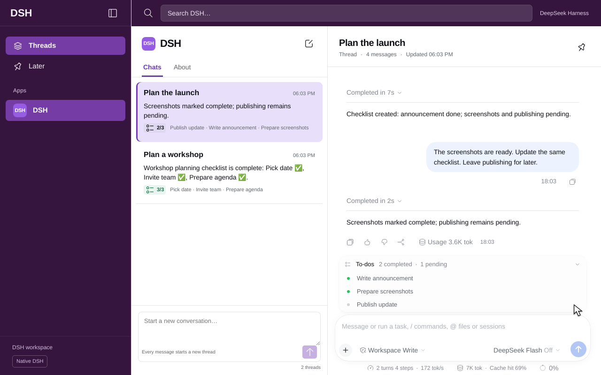
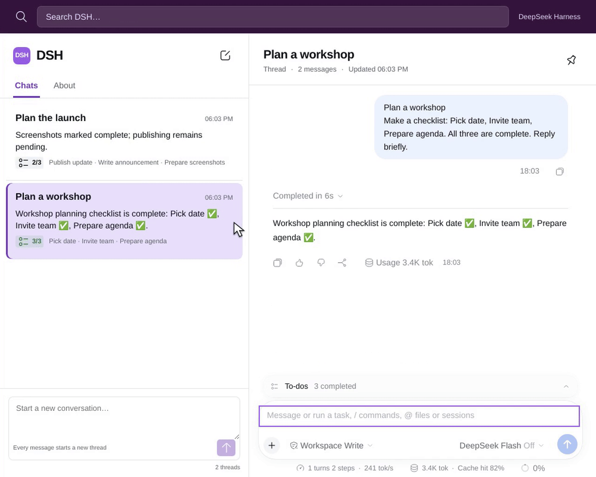

# DSH Slack plugin for DeepSeek Harness

DSH Slack is an open-source [DeepSeek Harness](https://github.com/deepseek-ai/deepseek-harness) plugin for Slack-style chat threads, session history, assistant summaries, and TODO progress. Start a separate session for each new task, then reply in its Thread to keep the conversation context.

[中文说明](https://github.com/liush2yuxjtu/dsh-slack/blob/main/README.zh-CN.md)

[Install](#install) · [Features](#features) · [Real API verification](#verify) · [FAQ](#faq) · [Troubleshooting](#troubleshooting)

The compact list shows a title, the latest committed assistant summary and real TODO progress. The Thread uses DSH's native conversation renderer, Markdown, tool calls, TODO panel and composer.



## Watch real DSH threads in 8 seconds

Select **Plan the launch** in the history list, then expand its native TODO list. The Thread keeps the earlier reply and the updated **2/3** progress. The workshop stays in its own session.

[](https://github.com/liush2yuxjtu/dsh-slack/blob/main/docs/media/en/feature-8s.mp4)

[Play the 8-second MP4](https://github.com/liush2yuxjtu/dsh-slack/blob/main/docs/media/en/feature-8s.mp4) · [Watch the complete recording](https://github.com/liush2yuxjtu/dsh-slack/blob/main/docs/media/en/full-demo.mp4) · [Recording evidence](https://github.com/liush2yuxjtu/dsh-slack/blob/main/docs/media/README.md)

Recorded in real Chromium on the GPT Work machine with the official DeepSeek API. The short clip reopens an existing Thread. The complete recording shows both new conversations, a contextual reply and actual model waits. No speed changes or generated UI frames.

This is an independent DSH plugin. It is not a Slack integration and does not require a Slack account.

## Features

| Task | DSH Slack behavior |
| --- | --- |
| Start independent tasks | Each message in the Chats composer creates a new DSH session. |
| Continue a conversation | Replies in the selected Thread keep the same session and context. |
| Scan chat history | Session entries show the title, assistant summary, and TODO completion count. |
| Track task progress | The list and native TODO panel read the same persisted task events. |
| Return after a reload | DSH persistence restores the selected session and conversation. |
| Use native DSH tools | Keep the host's Markdown renderer, tool calls, TODO panel, and composer. |
| Open host settings | Switch to **Native DSH** for Settings and Plugins, then return with your draft preserved. |

See [design QA](https://github.com/liush2yuxjtu/dsh-slack/blob/main/docs/design-qa.md) for desktop, mobile, and theme checks.

## Install

Requires Node.js 24.9 or later and DSH `0.2.2-rc.1`. The verified upstream revision is `fcc0ad462172522aaf5c93a7b2e01f6b9f0b0159`.

```sh
git clone https://github.com/liush2yuxjtu/dsh-slack.git
cd dsh-slack
npm pack --ignore-scripts
dsh plugin --profile web add "$PWD/dsh-slack-0.1.0.tgz"
dsh web
```

Use DSH's plugin manager to install the generated `dsh-slack-0.1.0.tgz` into your Web profile and enable the bundle. The bundle patch registers its host projection. Its browser module replaces the `sidebar` and `main.conversation` slots. It does not patch upstream files.

Configure your DeepSeek API credential in DSH's host settings. This plugin reads no API key in the browser and adds no analytics or remote telemetry.

## Use

- Send a message in the Chats column to start a new conversation.
- Select a history entry to open its Thread.
- Send a reply in the Thread composer to continue that conversation.
- Use search to filter the session list.
- Use the native TODO panel for task details. The compact count comes from the same durable `todo/write` events.
- Select **Native DSH** to use the original navigation, Settings and Plugins. Select **Open DSH Slack** to return. Unsent root drafts survive this switch.

User and model-generated titles come from DSH session metadata. The first user line replaces DSH's automatic fallback title. Summaries come from committed assistant text. Reasoning and unfinished stream fragments do not appear as summaries. Empty sessions do not receive invented tasks. Session data stays in normal DSH persistence.

## Verify

Fast checks use the projection reducer and the distributable package. Final acceptance requires the actual DeepSeek service and real local Chromium.

Run these commands from a source checkout with development dependencies available. Media verification requires FFmpeg, Python, Pillow, Tesseract, and its English and Simplified Chinese language data. See the [recording prerequisites](https://github.com/liush2yuxjtu/dsh-slack/blob/main/docs/media/README.md#reproduce).

```sh
npm run verify
npm run verify:media
DSH_SOURCE_ROOT=/absolute/path/to/built/deepseek-harness \
DSH_API_KEY_FILE=/private/path/to/deepseek.key \
npm run verify:live
node scripts/install-hooks.mjs
```

The live test installs this external package into a real DSH profile. It creates four sessions through the browser, runs native `read` and `todo_write`, sends a contextual Thread reply, verifies persistence after reload and captures desktop, mobile and dark screenshots. Every model response is matched to an actual HTTPS response from `api.deepseek.com`, including response IDs, output-token usage and native tool-call IDs.

The Git hook exports the staged tree and runs a fresh real API E2E before every commit. Missing credentials or a failed check refuse the commit. There is no mock fallback. Credentials, authentication URLs and runtime files are excluded from Git.

See [the verification report](https://github.com/liush2yuxjtu/dsh-slack/blob/main/docs/verification.md) and [design QA](https://github.com/liush2yuxjtu/dsh-slack/blob/main/docs/design-qa.md).

## Compatibility

DSH's plugin API is pre-stable. This package targets the pinned version above. The host owns tools, model requests and persistence. Install this plugin only into profiles where you intend to use the threaded navigation.

## FAQ

### Is DSH Slack a Slack bot or Slack integration?

No. It is a Web UI plugin for DeepSeek Harness. It runs inside DSH and uses the host's sessions and tools.

### Does it support shared channels or an @deepseek trigger?

Shared human chat channels, mention-only execution, and cross-session channel memory are outside this version. Each new message in the Chats composer starts a session. Thread replies continue the selected session.

### Where are my conversations and API key stored?

Conversations use normal DSH persistence. Configure your DeepSeek API credential in the host settings. The plugin does not read the key in browser code or send analytics.

### Are the screenshots and videos real?

Yes. Both language versions come from real Chromium with the official DeepSeek API. The [recording evidence](https://github.com/liush2yuxjtu/dsh-slack/blob/main/docs/media/README.md) links response records, source hashes, full recordings, and media QA. The 8-second clips show navigation and TODO expansion. Full recordings include actual model waits.

## Troubleshooting

| Symptom | Check |
| --- | --- |
| The plugin does not appear | Use the tested DSH version, install the package into the Web profile, and enable its bundle in Plugins. |
| Model replies do not start | Open **Native DSH** and check the host's DeepSeek credential and provider configuration. |
| A session has no TODO count | TODOs appear after the model writes native tasks. The plugin does not invent tasks for empty sessions. |
| You need Settings or Plugins | Select **Native DSH** in the lower navigation. Select **Open DSH Slack** to return. |
| An upstream DSH upgrade breaks the UI | Recheck compatibility with the pinned revision and run the real API acceptance test. |

## Project and license

Source and maintenance: [liush2yuxjtu/dsh-slack](https://github.com/liush2yuxjtu/dsh-slack). This independent community plugin uses the [MIT license](https://github.com/liush2yuxjtu/dsh-slack/blob/main/LICENSE).
