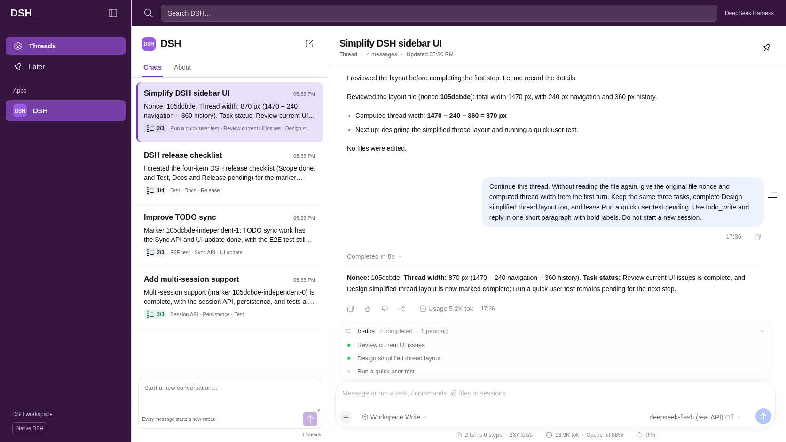

# DSH Slack

Slack-style session threads for [DeepSeek Harness](https://github.com/deepseek-ai/deepseek-harness). Each message in the Chats composer starts a new session. Reply in the selected Thread to keep its conversation context.

[中文说明](README.zh-CN.md)

The compact list shows a title, the latest committed assistant summary and real TODO progress. The Thread uses DSH's native conversation renderer, Markdown, tool calls, TODO panel and composer.



This is an independent DSH plugin. It is not a Slack integration and does not require a Slack account.

## Install

Requires Node.js 24.9 or later and DSH `0.2.2-rc.1`. The verified upstream revision is `fcc0ad462172522aaf5c93a7b2e01f6b9f0b0159`.

```sh
git clone https://github.com/liush2yuxjtu/dsh-slack.git
cd dsh-slack
npm pack --ignore-scripts
dsh plugin --profile web add "$PWD/dsh-slack-0.1.0.tgz"
dsh web
```

Use DSH's plugin manager to install the generated `dsh-slack-0.1.0.tgz` into your Web profile and enable the bundle. The bundle patch registers its host projection. Its browser module replaces the `sidebar` and `main.conversation` slots. It does not patch upstream files.

Configure your DeepSeek API credential in DSH's host settings. This plugin reads no API key in the browser and adds no analytics or remote telemetry.

## Use

- Send a message in the Chats column to start a new conversation.
- Select a history entry to open its Thread.
- Send a reply in the Thread composer to continue that conversation.
- Use search to filter the session list.
- Use the native TODO panel for task details. The compact count comes from the same durable `todo/write` events.
- Select **Native DSH** to use the original navigation, Settings and Plugins. Select **Open DSH Slack** to return. Unsent root drafts survive this switch.

User and model-generated titles come from DSH session metadata. The first user line replaces DSH's automatic fallback title. Summaries come from committed assistant text. Reasoning and unfinished stream fragments do not appear as summaries. Empty sessions do not receive invented tasks. Session data stays in normal DSH persistence.

## Verify

Fast checks use the projection reducer and the distributable package. Final acceptance requires the actual DeepSeek service and real local Chromium.

```sh
npm run verify
DSH_SOURCE_ROOT=/absolute/path/to/built/deepseek-harness \
DSH_API_KEY_FILE=/private/path/to/deepseek.key \
npm run verify:live
node scripts/install-hooks.mjs
```

The live test installs this external package into a real DSH profile. It creates four sessions through the browser, runs native `read` and `todo_write`, sends a contextual Thread reply, verifies persistence after reload and captures desktop, mobile and dark screenshots. Every model response is matched to an actual HTTPS response from `api.deepseek.com`, including response IDs, output-token usage and native tool-call IDs.

The Git hook exports the staged tree and runs a fresh real API E2E before every commit. Missing credentials or a failed check refuse the commit. There is no mock fallback. Credentials, authentication URLs and runtime files are excluded from Git.

See [the verification report](docs/verification.md) and [design QA](docs/design-qa.md).

## Compatibility

DSH's plugin API is pre-stable. This package targets the pinned version above. The host owns tools, model requests and persistence. Install this plugin only into profiles where you intend to use the threaded navigation.

MIT license.
