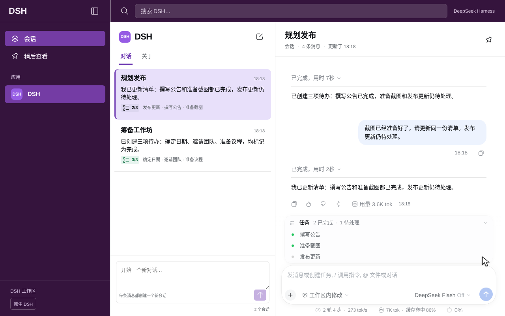
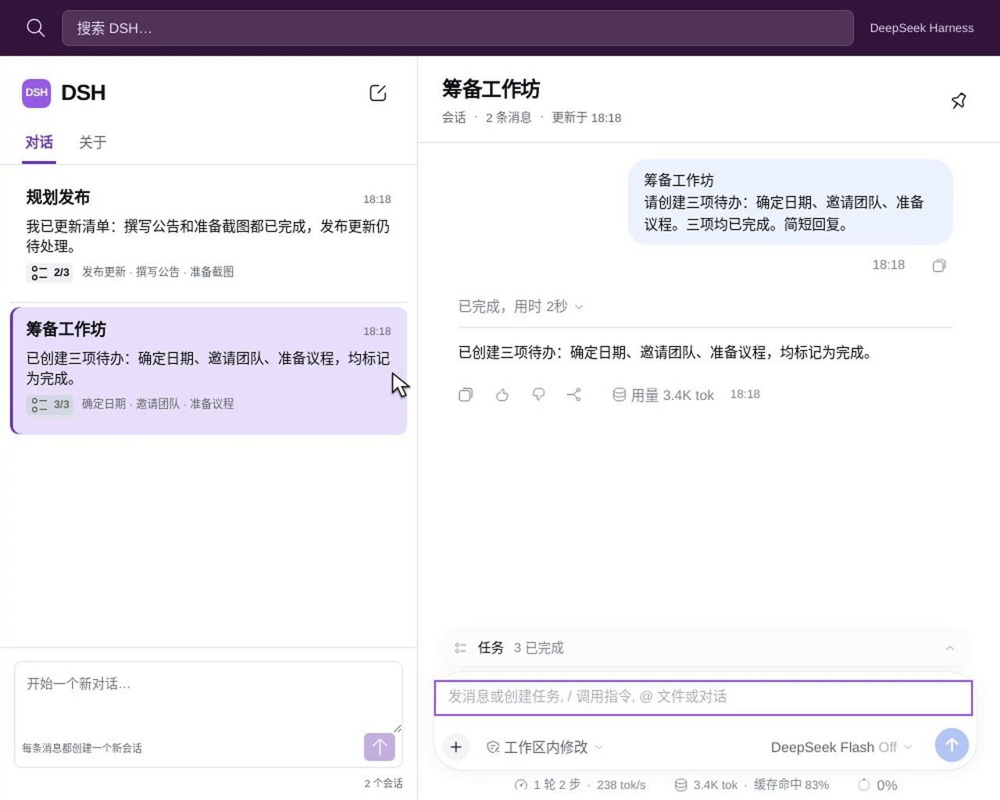

# DSH Slack

为 DeepSeek Harness 提供按 Thread 组织的会话界面。

在「对话」列表下方发送消息，每条消息创建一个独立 session。在右侧 Thread 回复，继续当前 session。列表显示标题、最新回复摘要和真实 TODO 进度。右侧保留 DSH 原生消息、Markdown、工具和输入框。

[English](README.md)



### 8 秒查看功能

在历史列表点击「规划发布」，展开原生待办清单。此前的回复和更新后的 **2/3** 进度都保留在同一个 Thread 中。「筹备工作坊」使用另一个独立 session。

[](docs/media/zh/feature-8s.mp4)

[播放 8 秒 MP4](docs/media/zh/feature-8s.mp4) · [查看完整原片](docs/media/zh/full-demo.mp4) · [录制与验收证据](docs/media/README.md)

画面来自 GPT Work 机器上的真实 Chromium，使用官方 DeepSeek API。8 秒短片展示重新打开已有 Thread。完整原片包含新建两个会话、继续回复和模型的实际等待时间。没有加速，也没有生成的界面帧。

## 安装

需要 Node.js 24.9 或更高版本，以及 DSH `0.2.2-rc.1`。

```sh
git clone https://github.com/liush2yuxjtu/dsh-slack.git
cd dsh-slack
npm pack --ignore-scripts
dsh plugin --profile web add "$PWD/dsh-slack-0.1.0.tgz"
dsh web
```

在 DSH 插件管理中启用此 bundle。DeepSeek API key 由 DSH Host 管理。插件不在浏览器读取密钥，也不添加远程遥测。

点击左下角 **原生 DSH**，恢复原生导航、Settings 和 Plugins。点击 **打开 DSH Slack** 返回。切换时保留未发送的新会话草稿。

## 验证

```sh
npm install
npm run verify
DSH_SOURCE_ROOT=/path/to/built/deepseek-harness \
DSH_API_KEY_FILE=/private/path/to/deepseek.key \
npm run verify:live
node scripts/install-hooks.mjs
```

最终验收运行真实 DSH、官方 DeepSeek API 和本机 Chromium。模型回复、工具调用、TODO 与 API 响应逐条核对。提交门禁从暂存文件导出候选版本，并重新运行真实 API 验收。缺少凭据或检查失败会拒绝提交。

查看 [验收报告](docs/verification.md)、[设计检查](docs/design-qa.md) 和 [英文说明](README.md)。

此插件提供 Slack 风格的 DSH 界面，不连接 Slack 服务。
