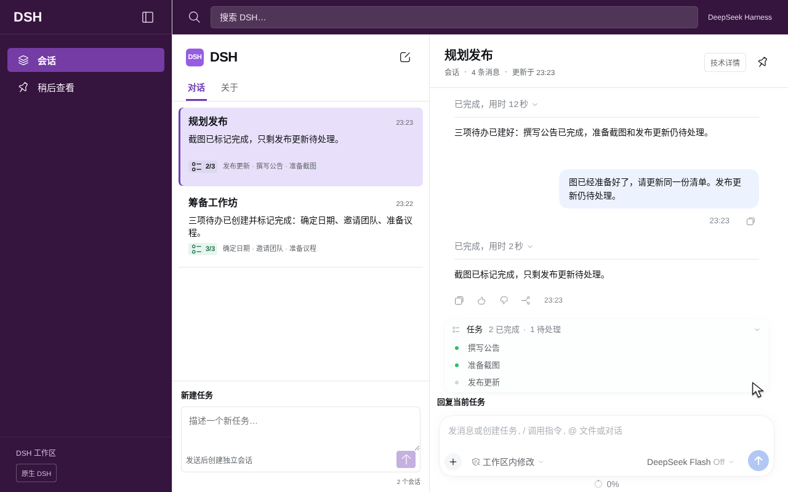

# 设计对照与真实截图验收

2026-11-10 本轮界面验收 PASS。对照用户提供的 1672×941 标注设计图，保留紫色导航、标题＋摘要＋TODO 列表，以及原生 DSH Thread。原图中的批注、窗口按钮和示例文字属于参考说明。

## 已关闭的差异

| # | 事项 | 归类 | 依据 | 可撤销做法 | 超时默认 | 选项 |
| --- | --- | --- | --- | --- | --- | --- |
| 1 | 新建任务与续聊输入框容易混淆 | 自动做 | 增加中英文「新建任务／回复当前任务」标签，提高新任务提示字号；[英文](evidence/ui-review/en.png) · [中文](evidence/ui-review/zh.png) | 回退插件提交 | — | — |
| 2 | 重复 DSH 导航入口 | 自动做 | 移除 Apps → DSH 重复入口；移动端保留宿主提供的唯一导航按钮 | Native DSH 保留原生导航 | — | — |
| 3 | 技术统计干扰任务阅读 | 自动做 | 每轮用量及底部性能统计默认收起；[技术详情展开](evidence/ui-review/09-details.png)可恢复；TODO、复制、时间和输入框保留 | 技术详情按钮与 Native DSH | — | — |
| 4 | 移动端侧栏动画遮挡截图 | 自动做 | 截图前确认侧栏已退出 viewport；[列表](evidence/ui-review/05-mobile-list.png) · [Thread](evidence/ui-review/05-mobile.png) | 仅修正截图就绪断言 | — | — |
| 5 | 深色主题与原生设置恢复 | 自动做 | [深色](evidence/ui-review/06-dark.png) · [Settings](evidence/ui-review/08-native-settings.png)；退出插件时回复标签贡献同步卸载 | Native DSH 来回切换 | — | — |
| 6 | 文档图片仍展示旧界面 | 自动做 | 更新中英文 README、官网首屏及分享图；旧视频明确标注保留此前界面 | 保留旧版媒体及来源记录 | — | — |

## 实际验收

固定宿主 DSH `0.2.2-rc.1`，提交 `fcc0ad462172522aaf5c93a7b2e01f6b9f0b0159`。GPT Work Linux，Node.js `v24.22.1`，官方 Debian Chromium Headless Shell `150.0.7871.100`。浏览器和依赖在用户目录运行，无系统安装或提权。

本轮 [运行记录](evidence/ui-review/result.json) ID `3d733477-9c7a-42d2-b22b-9eecdbbf8430` 包含 17 项浏览器检查与 12 次真实官方 DeepSeek HTTP 200 响应。每次保留 response ID、usage、响应哈希；mock、scripted model、预置助手消息和预置 TODO 均为 false。Console error 为 0。

中英文日常任务截图各有 6 次独立真实 API 响应，来源见 [英文](evidence/ui-review/en-provenance.json) 与 [中文](evidence/ui-review/zh-provenance.json)。截图对应的产品文件哈希记录在各来源文件中；source.commit 是录制起点的基线提交，候选产品内容以 source.sourceHashes 为准。

验证路径为新建两个独立任务 → 选择旧任务 → 在原生 Thread 续聊 → TODO 从 1/3 更新到 2/3。完整 E2E 另验证四个独立 session、随机文件上下文、刷新恢复、草稿、收藏、搜索、键盘、390×844 移动端与双向主题。

旧版基线见 [桌面对照](evidence/ui-review/before-desktop.png)。本轮按布局、可读性和真实交互验收。模型文本由真实 API 生成，原生消息与输入框沿用 DSH；未声明与标注概念图逐像素一致，也未进行完整 WCAG 或读屏器验收。

## 兼容边界

性能统计的隐藏仅作用于 `.dsh-slack-thread`，不修改宿主设置。底部使用宿主公开的 `data-composer-stat` 属性；单轮用量选择器依赖固定宿主的 message action 结构，真实 E2E 同时检查收起、展开和复制按钮可用。宿主升级时需重跑该检查。ContextMeter、模型选择、工作区权限、工具、TODO 和原生 composer 保留。

提交前仍从暂存树执行 `node scripts/pre-commit.mjs`，重新运行完整真实 API E2E。门禁回执记录的是即将提交的树，不把截图录制的调用次数混入门禁计数。
